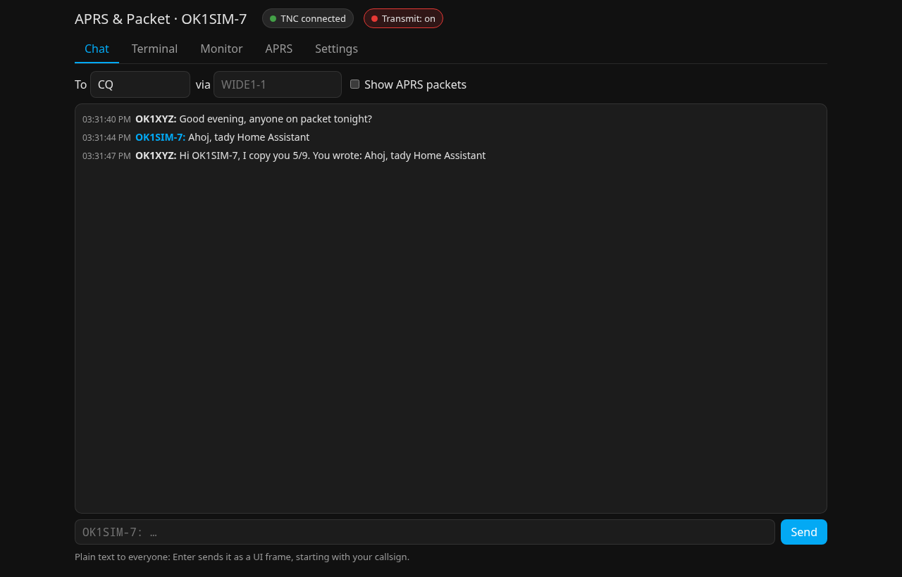
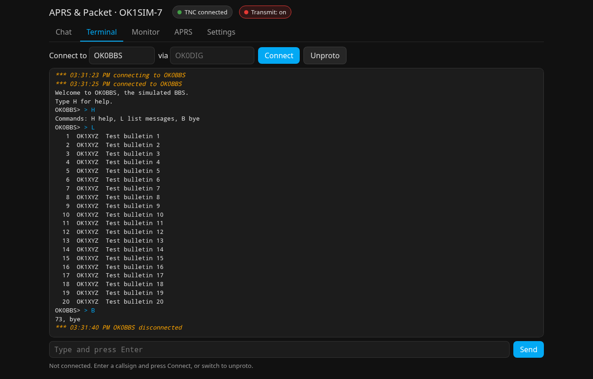
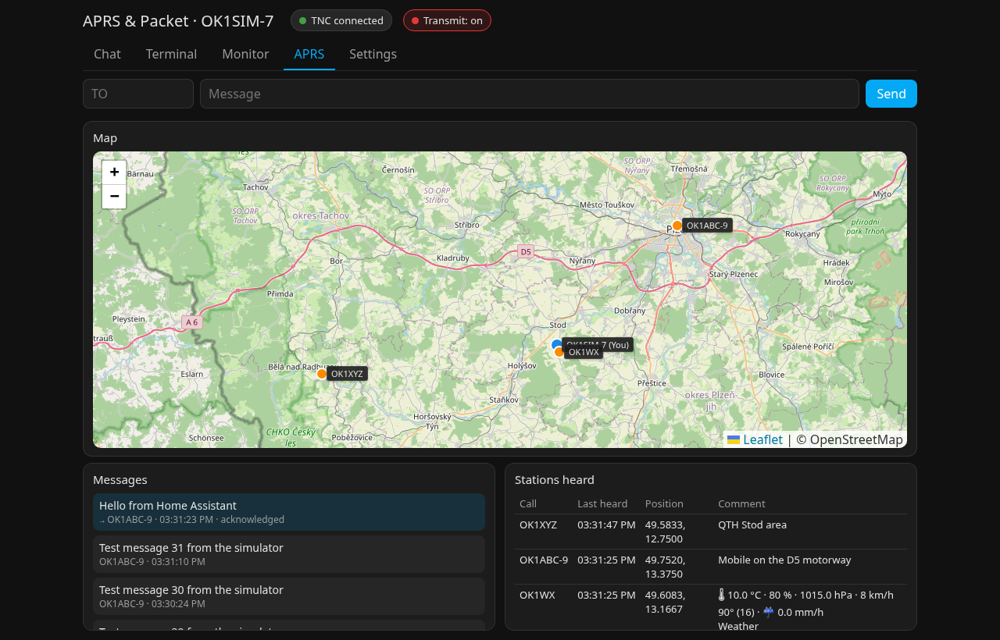
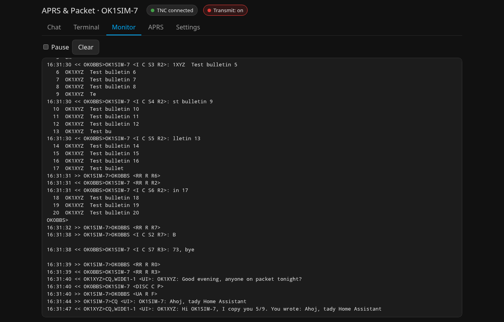
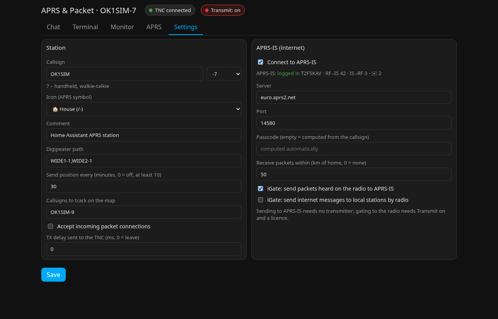

# APRS & Packet for Home Assistant (KISS TNC)

A Home Assistant integration that turns a radio with a **KISS TNC** into an **APRS station** and a **packet radio terminal**:

- **APRS**: receive positions, weather, status and messages; send messages (repeated until acknowledged), your position and status; a map of the stations you hear; incoming messages addressed to you are acknowledged automatically.
- **Packet radio terminal**: connect to a BBS, node or another station (AX.25 connected mode), type commands and read the answers; send unproto text; accept incoming connections if you want.
- **Chat**: a plain chat window. Type and press Enter: the text goes out to everyone as `OK1SIM-7: text`, and everything typed by others on the frequency appears below.
- **Monitor**: every frame heard and sent, in the classic TNC monitor format.
- **APRS-IS and iGate**: connect to the APRS internet network; gate what the radio hears to the internet, and internet messages for local stations to the radio; messages to you from the internet arrive in Home Assistant too.
- Home Assistant **entities, services and events**, so automations can react to APRS messages or send them.

It was built and tested for a **Quansheng UV-K1 / UV-K5 V3** running the **F4HWN** firmware with its **KISS TNC** app, connected by USB-C. Any KISS TNC works: Direwolf, a hardware TNC, a Mobilinkd, a NinoTNC, … over TCP or a serial port.

> [!WARNING]
> Transmitting requires an **amateur radio licence**. The integration starts with transmitting **switched off**; nothing is sent until you switch it on. Use your own callsign.

<table>
<tr>
<td width="50%"><picture><source media="(prefers-color-scheme: light)" srcset="assets/chat-light.png"></picture></td>
<td width="50%"><picture><source media="(prefers-color-scheme: light)" srcset="assets/terminal-light.png"></picture></td>
</tr>
<tr>
<td><b>Chat</b>: type and press Enter; everyone's text on the frequency below.</td>
<td><b>Terminal</b>: connected to a BBS, commands and answers.</td>
</tr>
<tr>
<td><picture><source media="(prefers-color-scheme: light)" srcset="assets/aprs-light.png"></picture></td>
<td><picture><source media="(prefers-color-scheme: light)" srcset="assets/monitor-light.png"></picture></td>
</tr>
<tr>
<td><b>APRS</b>: map of the stations heard, messages with their acknowledgement, weather.</td>
<td><b>Monitor</b>: every frame, received (&lt;&lt;) and sent (&gt;&gt;), with AX.25 control fields.</td>
</tr>
<tr>
<td colspan="2"><picture><source media="(prefers-color-scheme: light)" srcset="assets/settings-light.png"></picture></td>
</tr>
<tr>
<td colspan="2"><b>Settings</b>: callsign and SSID with their usual meaning, the APRS icon from the common symbols, beacon, tracked stations, APRS-IS and iGate.</td>
</tr>
</table>

*The panel follows Home Assistant's theme, light or dark; the screenshots follow your GitHub theme. They were taken with the built-in simulator (see [Testing without a radio](#testing-without-a-radio)); the stations are made up.*

## Contents

1. [What you need](#1-what-you-need)
2. [Prepare the radio (F4HWN KISS TNC)](#2-prepare-the-radio-f4hwn-kiss-tnc)
3. [Connect the radio to the network (KISS TCP bridge)](#3-connect-the-radio-to-the-network-kiss-tcp-bridge)
4. [Install the integration](#4-install-the-integration)
5. [Set it up](#5-set-it-up)
6. [First test: receive only](#6-first-test-receive-only)
7. [Transmit: APRS](#7-transmit-aprs)
8. [Packet radio terminal and chat](#8-packet-radio-terminal-and-chat)
9. [Entities, services and events](#9-entities-services-and-events)
10. [APRS-IS and iGate](#10-aprs-is-and-igate)
11. [Testing without a radio](#testing-without-a-radio)
12. [Troubleshooting](#12-troubleshooting)
13. [How it works](#13-how-it-works)

## 1. What you need

| | |
|---|---|
| **Radio** | Quansheng **UV-K1** or **UV-K5 V3** (the PY32F071 models; the old UV-K5 V1 has a different chip and is not supported by this firmware line) |
| **Firmware** | **F4HWN**, *Labs* edition **v6.3.0 or newer**, with the **KISS TNC** app |
| **Cable** | A USB-C **data** cable (not a charge-only one) and a **clip-on ferrite** (type 31 or 43) for the radio end |
| **Computer** | A Linux machine near the radio that runs the bridge: the Home Assistant host, a Proxmox host, a Raspberry Pi, … |
| **Home Assistant** | 2025.6 or newer; the map needs **2026.11** or newer (its tile proxy) |
| **Licence** | An amateur radio licence and your callsign, for transmitting |

You can also skip the bridge and plug the radio straight into the Home Assistant machine (see [3.4](#34-without-a-bridge-radio-plugged-into-home-assistant)).

## 2. Prepare the radio (F4HWN KISS TNC)

1. **Back up the radio** (calibration and settings) with your usual programming tool before flashing.
2. **Flash the F4HWN firmware, Labs edition v6.3.0 or newer.** The firmware and its web flasher are at [armel/uv-k1-k5v3-firmware-custom](https://github.com/armel/uv-k1-k5v3-firmware-custom). The flasher runs in a Chromium-based browser (Chrome, Edge) and needs the radio's programming cable.
3. **Install the KISS TNC app** with **UV Studio**, the app version that matches the firmware. Details: [App KISS TNC (wiki)](https://github.com/armel/uv-k1-k5v3-firmware-custom/wiki/App-KISS-TNC).
4. **Set the VFO** to your APRS frequency in **FM**, for example **144.800 MHz** in IARU Region 1 (Europe), 144.390 MHz in North America. Power and bandwidth also come from the VFO.
5. **Start the app**: press **F + 7**. The display shows `USB` / `NO USB`, `TX` / `RX ONLY`, frame counters and the last station heard. **EXIT** quits the app.
6. Useful keys inside the app: **3** toggles *RX only* (a safe start), **1** toggles the receive audio, **2** sends a test frame to the computer (not on air).
7. Clip the **ferrite** onto the USB cable next to the radio (two to four turns). Without it, RF can reset the USB port at every key-up.

## 3. Connect the radio to the network (KISS TCP bridge)

The radio appears on USB as a serial port that speaks KISS. The bridge in [`bridge/`](bridge) shares that port on the network as a **KISS TCP server**, so Home Assistant (running anywhere) connects to it. It uses only the Python standard library and **reopens the port by itself** when the radio's USB resets.

### 3.1 Find the radio's serial port

On the machine the radio is plugged into:

```bash
ls -l /dev/serial/by-id/
```

Use the `/dev/serial/by-id/usb-…` path, not `/dev/ttyACM0`: the by-id name stays the same when the port comes back after a reset.

If nothing appears: check that the cable carries data (`dmesg -w` while plugging it in should show a new USB device) and that the KISS TNC app is running.

### 3.2 Install the bridge

```bash
# as root on the machine with the radio
curl -fsSL -o /usr/local/bin/kiss_tcp_bridge.py \
  https://raw.githubusercontent.com/michalsiman/aprs-kiss-ha/main/bridge/kiss_tcp_bridge.py
chmod +x /usr/local/bin/kiss_tcp_bridge.py

# try it by hand first (Ctrl+C to stop)
python3 /usr/local/bin/kiss_tcp_bridge.py --device /dev/serial/by-id/usb-XXXX --port 8001 --debug
```

You should see `Serial port … open` and `KISS TCP server on 0.0.0.0:8001`.

### 3.3 Run it as a service

```bash
curl -fsSL -o /etc/systemd/system/kiss-tcp-bridge.service \
  https://raw.githubusercontent.com/michalsiman/aprs-kiss-ha/main/bridge/kiss-tcp-bridge.service
nano /etc/systemd/system/kiss-tcp-bridge.service   # set --device and --allow (see below)
systemctl daemon-reload
systemctl enable --now kiss-tcp-bridge
journalctl -u kiss-tcp-bridge -f                   # watch it
```

- `--device`: the by-id path from 3.1.
- `--allow`: the address of your Home Assistant (repeat for more, or give a network like `192.168.0.0/24`). Without `--allow` anyone on the network may use the TNC, and so transmit with your callsign.
- `--port`: 8001 by default.

**Proxmox users:** run the bridge on the Proxmox host itself (plug the radio into the host). Home Assistant's VM then needs no USB passthrough, and a USB reset at key-up does not disturb the VM.

### 3.4 Without a bridge: radio plugged into Home Assistant

If the radio is plugged into the machine that runs Home Assistant (Home Assistant OS on a Raspberry Pi or a mini PC, or a VM with USB passthrough), choose **serial port** in the setup and give the `/dev/serial/by-id/…` path. The bridge is not needed. USB resets are handled the same way (the integration reconnects).

## 4. Install the integration

**With HACS / the Marketplace (recommended)**

1. HACS → ⋮ → *Custom repositories* → add `https://github.com/michalsiman/aprs-kiss-ha`, type *Integration*.
2. Install **APRS & Packet (KISS TNC)**.
3. Restart Home Assistant.

**By hand**

Copy `custom_components/aprs_kiss` into your Home Assistant `config/custom_components/` folder and restart Home Assistant.

## 5. Set it up

Settings → Devices & services → **Add integration** → **APRS & Packet (KISS TNC)**.

1. **Where is the KISS TNC?**
   - *On the network (KISS over TCP)*: host = the machine running the bridge, port = 8001.
   - *On a serial port of this machine*: the `/dev/serial/by-id/…` path (speed is ignored by USB radios).

   The radio does not have to be on yet: the integration keeps trying to connect.
2. **Station**
   - *Callsign with SSID*: e.g. `OK1SIM-7` (SSID 7 is customary for handhelds, 9 for cars, 10 for internet gateways).
   - *Digipeater path*: `WIDE1-1,WIDE2-1` is the usual APRS path; leave empty for direct only.
   - *APRS symbol*: two characters, table and code: `/-` house, `/>` car, `/[` person, `/k` truck.
   - *Position comment*: sent with your position.
   - *Accept incoming packet connections*: lets other stations connect to you (only while transmitting is on).

Everything can be changed later in the panel's **Settings** tab: callsign and SSID (the list shows the usual meaning of each SSID: -7 handheld, -9 car, -10 iGate, …), the **icon** from the most common APRS symbols, comment, path, a **regular position beacon**, callsigns to track on the map, incoming connections, TX delay, and **APRS-IS / iGate**. Saving restarts the integration with the new settings. (The integration's *Configure* button offers the station options too.)

A new sidebar item **APRS & Packet** opens the panel (administrators only).

## 6. First test: receive only

Keep **Transmit off** (the default). In the panel:

- The header shows **TNC connected** once the bridge and the radio are up.
- **Monitor** lists every frame the radio decodes. On 144.800 MHz you should see APRS traffic within minutes, depending on the area.
- **APRS** shows the stations heard, their positions on the map and their weather.

The entity *TNC connected* and the counter *Packets received* show the same in Home Assistant.

## 7. Transmit: APRS

1. Make sure the radio is **not** in *RX only* (key 3 in the app) and the antenna is connected.
2. Switch on **Transmit**: the switch entity, or the *Transmit* button in the panel header.
3. **Send your position**: the *Send position* button (it uses Home Assistant's home location) or the service `aprs_kiss.send_position`.
4. Check it on [aprs.fi](https://aprs.fi) a minute later, if an iGate hears you.
5. **Send a message**: APRS tab, *To* + text → *Send*. The message is repeated after 30, 60, 120 and 240 seconds until the recipient acknowledges it; the panel shows *waiting for ack*, *acknowledged* or *no ack*.

Limits: at least 3 seconds between frames and at most 30 frames in 10 minutes (APRS); messages up to 67 characters.

## 8. Packet radio terminal and chat

**Chat** (the first tab) is the simplest way to talk: type a line and press **Enter**. It is sent to everyone as an unproto UI frame to `CQ` (or another destination, optionally via digipeaters), starting with your callsign: `OK1SIM-7: Hello`. Everything others type on the frequency appears below with time and callsign. APRS packets are hidden there by default; *Show APRS packets* shows them too. Only transmitting must be switched on.

**Connect to a station** (a BBS, a node, another terminal):

1. Terminal tab → *Connect to*: the callsign, e.g. `OK0BBS`; *via*: digipeaters if needed, e.g. `OK0DIG` (comma separated).
2. *Connect*. The status line shows *connecting*, then *connected* and the station's greeting.
3. Type a command and press **Enter**. Each line ends with CR, as packet BBSes expect.
4. *Disconnect* when you are done (or the station disconnects you).

**Unproto**: the *Unproto* button switches the line to UI frames (no connection), sent to `CQ` or another destination, optionally via digipeaters. Received unproto frames appear in the Monitor.

**Incoming connections**: enable *Accept incoming packet connections* in the options. Other stations can then connect to your callsign while transmitting is on; their session appears in the terminal under their callsign.

Link parameters (AX.25 v2.0, modulo 8): 128 bytes per frame, window 4, T1 12 s, 8 tries, idle check every 5 minutes. Lost frames are sent again; out-of-order frames are rejected and resent.

## 9. Entities, services and events

**Entities** (one device per callsign)

| Entity | |
|---|---|
| Switch *Transmit* | on/off; off after setup, kept over restarts |
| Binary sensor *TNC connected* | with the reconnect count and the last error |
| Sensor *Last packet from* | callsign; attributes: format, path, position, comment, raw packet |
| Sensor *Last message* | text of the last APRS message addressed to you; attributes: from, number, time |
| Sensor *Stations heard* | count |
| Sensors *Packets received*, *Frames sent* | counters |
| Button *Send position* | Home Assistant's home location |
| Device trackers | one per callsign in *callsigns to track*; position from their packets, weather as `wx_*` attributes |

**Services**

```yaml
action: aprs_kiss.send_message
data:
  to: OK1ABC-9
  text: The garage door is open
---
action: aprs_kiss.send_position      # Home Assistant's home unless latitude/longitude are given
data:
  comment: QRV 144.800
---
action: aprs_kiss.send_status
data:
  text: Home Assistant APRS station
---
action: aprs_kiss.send_unproto
data:
  destination: CQ
  text: Hello from Home Assistant
  path: WIDE1-1
```

`send_message` returns the message id and state when called with a response variable.

**Events**

- `aprs_kiss_message`: an APRS message addressed to you (`from`, `text`, `msg_no`, `path`).
- `aprs_kiss_packet`: every APRS packet decoded (`from`, `format`, `latitude`, `longitude`, `weather`, `comment`, `raw`, …).

**Automations from a position**: put a callsign (for example your car, `OK1SIM-9`) into *callsigns to track* in the options. Its `device_tracker` then follows the positions it sends, and Home Assistant's zones work with it like with a phone:

```yaml
triggers:
  - trigger: zone
    entity_id: device_tracker.ok1sim_9
    zone: zone.home
    event: enter
actions:
  - action: light.turn_on
    target:
      entity_id: light.garden
```

The position is as fresh as the station's beacon (every 1–5 minutes typically, more often with smart beaconing). The Proximity integration can use the tracker too (distance and direction to home).

Example: forward APRS messages to your phone.

```yaml
triggers:
  - trigger: event
    event_type: aprs_kiss_message
actions:
  - action: notify.mobile_app_my_phone
    data:
      title: "APRS from {{ trigger.event.data.from }}"
      message: "{{ trigger.event.data.text }}"
```

## 10. APRS-IS and iGate

APRS-IS is the internet side of APRS ([aprs-is.net](https://www.aprs-is.net)); [aprs.fi](https://aprs.fi) shows what reaches it. In **Settings → APRS-IS**:

1. **Connect to APRS-IS**: server `euro.aprs2.net` (or `rotate.aprs2.net`, `noam.aprs2.net`, …), port 14580. The **passcode** is computed from your callsign automatically; enter one only if yours differs. The status line shows *logged in* and the server once the server has verified the passcode.
2. **Receive packets within … km**: a range filter around Home Assistant's home for the internet traffic the integration receives.
3. **Messages to you from the internet** arrive like radio messages (event `aprs_kiss_message`, sensor *Last message*) and are acknowledged over the internet.
4. **Your own packets** (position, status, messages) go to APRS-IS as well while connected, also with transmitting off: Home Assistant can then message APRS stations through the internet alone.

**iGate** (both switches are off by default):

| Switch | What it does | Needs |
|---|---|---|
| *Send packets heard on the radio to APRS-IS* (RX iGate) | Every APRS packet heard on RF goes to APRS-IS with `qAR,<your call>`. Packets with `NOGATE`, `RFONLY`, `TCPIP` or `TCPXX` in their path, queries and third-party internet traffic are not gated. | APRS-IS connection; no transmitter |
| *Send internet messages to local stations by radio* (TX iGate) | A message from APRS-IS to a station heard **on RF in the last 30 minutes** (and not itself on RF) is transmitted in the third-party format `}FROM>TO,TCPIP,<your call>*:…`. Positions and other traffic are not sent to RF. | Transmit on, licence |

Use the SSID **-10** and the symbol **iGate** (`I&`, or `R&` for receive only) for a station that runs as an iGate. The entity *APRS-IS connected* has the counters (RF→IS, IS→RF, messages from the internet).

## Testing without a radio

`tests/fake_tnc.py` is a simulated KISS TNC on TCP. It "receives" APRS positions, weather, a status and messages to your callsign every few seconds, acknowledges your messages to `OK1ABC-9`, and runs a small BBS `OK0BBS` you can connect to (commands `H`, `L`, `B`).

```bash
python3 tests/fake_tnc.py --port 8001 --mycall OK1SIM-7 --interval 20
```

Point the integration at that machine and port 8001.

Unit tests (KISS, AX.25, APRS, AX.25 sessions with lost frames, weather) run without Home Assistant:

```bash
python3 -m unittest discover -s tests -t .
```

## 12. Troubleshooting

| Problem | What to do |
|---|---|
| *TNC connected* stays off | Is the bridge running (`journalctl -u kiss-tcp-bridge -f`)? Is Home Assistant's address in `--allow`? Can Home Assistant reach port 8001 (firewall)? |
| Bridge says *Serial port not available* | Is the KISS TNC app running on the radio (F + 7)? Right `/dev/serial/by-id/` path? A data cable? |
| The connection drops when transmitting | RF on the USB cable resets the radio's USB port. Add a ferrite (2–4 turns) at the radio end, use a short cable, keep it away from the antenna. The bridge and the integration reconnect by themselves; the radio's display counts resets as `re`. |
| Nothing received | Right frequency and FM mode in the VFO? Squelch open enough? Receive audio on (key 1) to hear the packets. |
| Frames sent but nobody hears them | *RX only* off (key 3)? Power in the VFO? Try a longer TX delay in the options (e.g. 300 ms). |
| A message stays *waiting for ack* | The recipient or the digipeater did not hear it, or their ack did not come back. It is retried 4 times, then marked *no ack*. |
| Map is empty | Positions come only from stations that send them. The map background comes through Home Assistant's tile proxy (2026.11 or newer), so Home Assistant needs internet; the browser does not. |

Debug logging:

```yaml
logger:
  logs:
    custom_components.aprs_kiss: debug
```

## 13. How it works

```
Quansheng UV-K1/K5 V3 (F4HWN KISS TNC app, AFSK 1200 Bd)
   │ USB-C (serial, KISS)
Linux host: kiss_tcp_bridge.py  ──TCP :8001──►  Home Assistant: aprs_kiss
                                                 ├─ KISS framing, AX.25 frames
                                                 ├─ APRS (aprslib for parsing)
                                                 ├─ AX.25 v2 connected sessions
                                                 └─ panel, entities, services, events
```

**Everything comes from Home Assistant**: the panel and the map library (Leaflet, bundled) are served by Home Assistant, and the OpenStreetMap tiles come through Home Assistant's own tile proxy (`/api/map_tiles`, short-lived token). The browser never contacts another server.

The radio only modulates and demodulates; everything above (APRS, acknowledgements, connected-mode link layer with numbering, windows, retransmission) runs in the integration. APRS packets are sent with the tocall `APZHAK` (the experimental range).

## Credits and licence

- KISS TNC app for F4HWN by **F4WAT**, F4HWN firmware by **Armel F4HWN**.
- APRS parsing by [aprslib](https://github.com/rossengeorgiev/aprs-python).
- Maps by [Leaflet](https://leafletjs.com) 1.9.4 (BSD-2-Clause, bundled: `frontend/vendor/LEAFLET-LICENSE`), map data © OpenStreetMap contributors.
- Written by [Michal Šiman](https://github.com/michalsiman) ([OK1SIM](https://ok1sim.cz/)) together with [Claude Code](https://claude.com/claude-code).

MIT licence, see [LICENSE](LICENSE).
